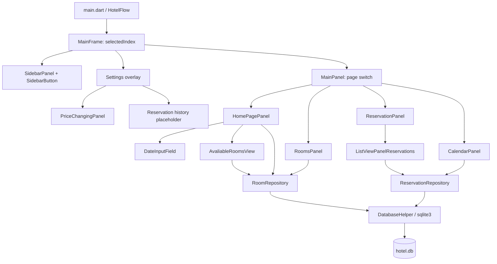
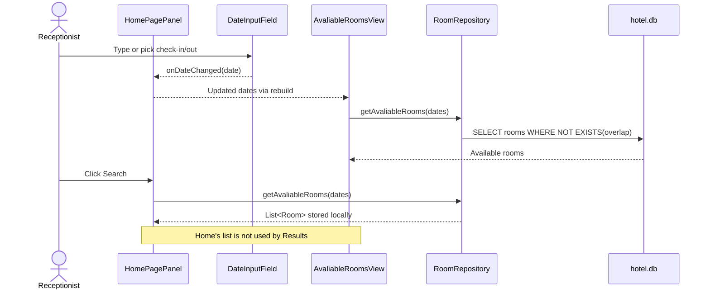
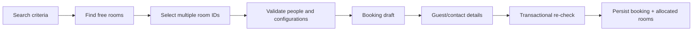

# HotelFlow — Architecture

**Snapshot:** 2026-11-09 · **development prototype**.

This document describes **what the source code implements today**, where it differs from the intended design, and the next architectural steps. Directory names and method names preserve their current spelling.

## 1. Architectural goals and constraints

HotelFlow targets a small hotel's reception desk. The present scope is a **single Windows desktop process** working with one embedded SQLite file. The app is designed for 24 known rooms and date-based bookings. Polish labels and a simple sidebar reduce the number of actions reception staff need to perform. The UI should remain responsive, data should remain consistent, and the code should permit later changes without stuffing SQL into widget trees.

Out of scope for the current build: server/API, synchronization among multiple computers, accounts and roles, email automation, confirmed production data migration, multi-room reservation persistence, and a polished historical-record screen.

## 2. Layer diagram

This is a **pragmatic layered UI/repository/database structure**, not a full clean-architecture implementation. Some widgets still instantiate repositories directly and run synchronous database operations during UI lifecycle methods.

## 3. Startup and navigation

`main.dart`:

1. Calls `WidgetsFlutterBinding.ensureInitialized()`.
2. Starts `HotelFlow`, which displays `HotelFlowSplashScreen`.
3. Initializes the database, creates tables, applies the additive reservation-total migration, and seeds rooms.
4. Keeps the splash visible for at least five seconds.
5. Shows `MainFrame` after initialization completes; initialization errors are displayed as an error screen.

`MainFrame` is a `StatefulWidget` owning `selectedIndex` and the Settings overlay state. `SidebarPanel` receives `selectedIndex` and `onPageSelected`; Settings opens above the main content. `MainPanel` maps the other selections to Home, Rooms, Reservations, Calendar, and Guests. `SidebarButton` is reused by the main sidebar and Settings navigation. The flow does not use named routes.

## 4. UI components and responsibilities

| File / component | Responsibility now | Limitations / follow-up |
| --- | --- | --- |
| `home_page_panel.dart` | Owns selected check-in/out dates, guest count, form validity flags; triggers availability query | Local `avaliableRooms` is set but **not passed into** the results widget; search results can show before Search and stale/invalid dates can affect results |
| `date_input_field.dart` | Reusable text input with `YYYY-MM-DD` parser, date picker, `firstDate`, `onDateChanged`, `onValidityChanged` | Ensure manual date also respects `firstDate`; account for invalid edited text and parent-driven updates |
| `avaliable_rooms_homepage.dart` | Holds an availability list and reloads when input dates change | No room selection state; `onRoomPressed` currently receives an empty handler in Home; no explicit Search trigger |
| `rooms_panel.dart` / `room_button.dart` | Lists rooms and opens room details | `loadRooms()` is called during `build` and during item creation; cache once instead of repeated DB queries |
| `reservation_panel.dart` | Maintains `page=0`, `pageSize=20`, left/right buttons, detail dialog | Forward button never disables at last page; no total count, search field, or refresh flow |
| `list_view_panel_reservations.dart` | Fetches page in `initState()`, refreshes in `didUpdateWidget()`, builds lazy list | Synchronous query and no explicit reload when records change without `page` change |
| `calendar_panel.dart` | Date picker, selected-date reservation cards, status badges, detail preview, deletion | Broader historical reservation workflow is not implemented |
| `in_this_day_reservations.dart` | Lists reservations for a chosen day | Own nested `Scaffold`/`AppBar`; simpler embedded list would reduce layout complexity |
| `bed_configuration.dart` | Defines six enum cases | Not connected to room/booking models or persisted |
| `settings.dart` | Settings overlay navigation with Cennik and reservation-history placeholder | History content is not implemented |
| `price_changing_panel.dart` | Capacity-based and extra-bed nightly price editing | Seasonal pricing and per-room persistent price breakdown are not implemented |
| `hotel_flow_splash_screen.dart` | Five-second Flutter startup screen with HotelFlow branding | Uses a fixed minimum delay |

### Current booking-search flow

**Recommended improvement:** keep dates and guest count as form/draft state; on Search, validate and set a committed search criteria object; obtain one result list; pass it to a stateless results widget. Then implement multi-selection (`Set<int>` room IDs), sum permitted capacity, and pass a booking draft to the next step. Ensure a new Search invalidates previous selections.

### Current paginated reservations flow

`ReservationPanel` owns `page` and sends it to `ListViewPanelReservations(page, pageSize, onReservationPressed)`. The child loads `List<Reservation>` via `getReservationsPage()` in `initState()` and when `page/pageSize` change in `didUpdateWidget()`. `ListView.builder` lazily constructs visible tiles, while SQLite `LIMIT/OFFSET` restricts fetched records. Both optimizations serve different purposes.

**Next:** `countCurrentReservations()`, prevent increment beyond the last page, reset `page` when filters change, and search with database-side filtering before `LIMIT/OFFSET`.

### Current calendar flow

`CalendarPanel` holds `selectedDate` and `reservations`; `initState()` loads today's records, and selecting a date invokes `loadReservations(date)`. Each card displays a `Przyjazd`, `Aktualna`, or `Wyjazd` badge and opens the reservation preview/deletion flow.

## 5. Data and domain layer

Models:

- `Room`: `id`, `roomNumber`, `capacity`, `extraBed` and `toString()`.
- `Reservation`: guest, dates, multiple reserved rooms, per-room bed/extra-bed maps, and `totalGrosze`.
- `PricingSettings`: capacity-2, capacity-4, and extra-bed rates in integer grosze.
- `BedConfigurations`: capacity-aware enum values persisted through `reservation_rooms`.

Repositories:

- `RoomRepository`: `addRoom`, `getAllRooms`, `getAvaliableRooms`.
- `ReservationRepository`: multi-room `addReservation`, `getReservationsForDate`, `getReservationsPage`, deletion, and reservation-total persistence.
- `PricingRepository`: reads and writes singleton capacity-based pricing settings.
- `DatabaseHelper`: opens DB, enables foreign keys, creates tables and indexes, seeds room/test booking data.

No separate service layer, state-management library, or repository interfaces exist yet. Introduce these only when the complexity of the multi-step booking flow justifies them.

## 6. Current multi-room booking architecture

The current workflow stores one reservation header and one row per assigned room in `reservation_rooms`, with guest details, dates, bed configurations, and extra-bed choices shared through the reservation. Availability and transactional overlap hardening remain follow-up work. See [`database.md`](database.md).

## 7. Reliability and performance priorities

1. **Availability correctness:** treat dates as `[checkIn, checkOut)`, disallow same-day/negative stays, and re-check availability when saving inside a transaction.
2. **Storage:** synchronous `sqlite3` queries can block the UI isolate; small data is unlikely to be an issue but heavy operations should move off the UI isolate if profiling warrants it.
3. **Query efficiency:** use `NOT EXISTS` for free-room checks and maintain indexes for reservation dates and room assignments.
4. **Pagination:** `LIMIT/OFFSET` plus `ListView.builder` and result count; the initial hotel is small but bookings accumulate.
5. **Data protection:** keep real guest data out of Git, turn off sample booking seeding, choose a suitable local DB location, add backup/restore and retention safeguards.
6. **Separation of concerns:** keep SQL in repositories, remove unused imports/empty callbacks, prefer immutable widget input and plain `Room`/`Reservation` models.
7. **Testing:** add overlapping interval, adjacent stays, same-day date, guest capacity, seed idempotency, last-page and invalid-input tests.

## 8. Implementation history and status

- **4 Nov:** initial project, page shell, sidebar navigation, visual theming (GitHub commit history).
- **5–6 Nov:** SQLite schema, repositories, fixed room inventory, calendar, paging and early reusable widgets developed through iterative implementation and discussions.
- **7 Nov:** latest `main` includes full files for those features and two dated commits addressing availability dates and Home screen (`e70817f`, `846796e`). Other files were committed in aggregate rather than feature-by-feature.

This is an architectural snapshot, not a statement that every UI flow is complete or tested.
