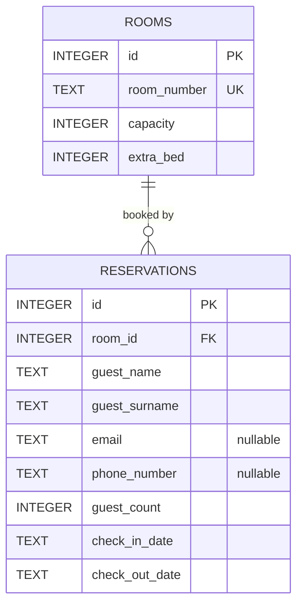

# HotelFlow — Database and Data Integrity

**Snapshot:** 7 November 2026, GitHub `main` `846796ed`. Source: `lib/database/database_helper.dart`, `room_repository.dart`, `reservation_repository.dart`. This is documentation of the **current schema**, with proposed improvements explicitly identified.

## 1. Storage architecture

HotelFlow uses an **embedded SQLite database** opened by the Dart `sqlite3` package (`sqlite3.open(dbPath)`), not a remote SQL server and not `sqflite`. The connection is held in `DatabaseHelper._database`. Initialization awaits `getApplicationDocumentsDirectory()`, joins the filename `hotel.db` using the `path` package, and executes `PRAGMA foreign_keys = ON;`.

As coded, data resides in the user's application Documents directory. On Windows this can be redirected to OneDrive; a local, non-synced application-data directory is preferable for a production SQLite file. `DatabaseHelper.createTables()` creates schema at startup; **there is no migration/versioning mechanism yet**.

**Safety:** the database contains personal data (guest name, optionally email/phone). Never add `hotel.db` or real guest data to this public GitHub repository. Back up the database before changing schema or editing it in DB Browser for SQLite.

## 2. Current ER diagram



A reservation currently refers to exactly **one** room through `room_id`. It cannot yet represent a group booking spanning several room records as one logical booking.

## 3. Schema: `rooms`

| Column | SQLite type | Rule | Meaning |
| --- | --- | --- | --- |
| `id` | `INTEGER` | `PRIMARY KEY AUTOINCREMENT` | Internal room ID |
| `room_number` | `TEXT` | `NOT NULL UNIQUE` | Human-readable room number, e.g. `'12'` |
| `capacity` | `INTEGER` | `NOT NULL` | Base occupants (seed: 2 or 4) |
| `extra_bed` | `INTEGER` | `NOT NULL DEFAULT 0 CHECK(extra_bed IN (0,1))` | 0/1 extra-bed option |

`RoomRepository.addRoom()` checks only nonempty room number and positive capacity. Room size is a business rule; it is not enforced by the SQL table constraint. Since inventory is fixed for this hotel, regular UI creation of arbitrary rooms may not be necessary.

### Inventory seeding

`DatabaseHelper.seedRooms()` loops from 1 through 24 and executes `INSERT OR IGNORE` into `rooms`. Rooms **12 and 24** have capacity **4** and `extra_bed = 0`; every other room has capacity **2** and `extra_bed = 1`.

`INSERT OR IGNORE` prevents duplicates where `room_number` already exists. **It does not repair existing incorrect capacity values.** Changing seeded rules does not automatically update an existing database.

## 4. Schema: `reservations`

| Column | SQLite type | Rule | Meaning |
| --- | --- | --- | --- |
| `id` | `INTEGER` | `PRIMARY KEY AUTOINCREMENT` | Reservation row ID |
| `room_id` | `INTEGER` | `NOT NULL`, FK → `rooms(id)` | Booked room |
| `guest_name` | `TEXT` | `NOT NULL` | Contact's first name |
| `guest_surname` | `TEXT` | `NOT NULL` | Contact's surname |
| `email` | `TEXT` | nullable | Contact email |
| `phone_number` | `TEXT` | nullable | Contact phone |
| `guest_count` | `INTEGER` | `NOT NULL CHECK(guest_count > 0)` | Number of guests in this room |
| `check_in_date` | `TEXT` | `NOT NULL` | Arrival date |
| `check_out_date` | `TEXT` | `NOT NULL` | Departure date |

Other constraints in code: `FOREIGN KEY (room_id) REFERENCES rooms(id) ON DELETE RESTRICT` and table-level `CHECK(check_in_date < check_out_date)`; SQLite accepts the table constraint as written in the current schema. Verify existing database structure separately: `CREATE TABLE IF NOT EXISTS` does **not** retrofit constraints to an old table.

Dates are written by `ReservationRepository.addReservation()` as ISO calendar-day strings `YYYY-MM-DD`, via `.toIso8601String().split('T')[0]`. The test seeder uses the same format. The day and pagination queries sometimes apply `DATE(column)`; the availability query compares ISO strings directly.

### Important integrity gaps

- **Double-booking is not prevented on regular writes.** `ReservationRepository.addReservation()` has no overlap query or transaction. Only `seedReservations()` performs an overlap check.
- **Over-capacity reservations can be stored** by `addReservation()`: no SQL or repository validation checks `guest_count <= room.capacity` or optional extra-bed rules.
- **Zero-night stays:** repository validation rejects `checkInDate.isAfter(checkOutDate)` but does not itself reject equality; table CHECK rejects equal stored date strings. Validate before writing, with clear UI feedback.
- **Date normalization:** repository validity checks compare full `DateTime` values, then persist only the date. Normalize to calendar dates first.
- **Current/upcoming boundary:** `getReservationsPage()` uses `DATE(check_out_date) >= DATE('now')`; SQLite `'now'` defaults to UTC, which may differ from local hotel dates near midnight. Choose hotel-local calendar dates explicitly.
- **One room per record:** no linked group/booking identifier, allocated occupancy per multiple rooms, or bed layout persistence.

## 5. Reservation overlap and availability

A booking occupies a **half-open interval** `[check_in_date, check_out_date)`. Two bookings for the same room overlap exactly when:

```sql
existing.check_in_date < requested_check_out
AND existing.check_out_date > requested_check_in
```

Examples:

| Existing | Requested | Conflict? |
| --- | --- | --- |
| Nov 10–12 | Nov 11–13 | Yes |
| Nov 10–12 | Nov 12–14 | No: checkout and check-in meet |
| Nov 10–12 | Nov 8–10 | No |
| Nov 10–12 | Nov 10–12 | Yes |
| Nov 10–15 | Nov 11–12 | Yes |

`RoomRepository.getAvaliableRooms(checkIn, checkOut)` uses the following idea (method name retains the spelling in the repository):

```sql
SELECT rooms.*
FROM rooms
WHERE NOT EXISTS (
  SELECT 1
  FROM reservations AS r
  WHERE r.room_id = rooms.id
    AND r.check_in_date < ?
    AND r.check_out_date > ?
)
ORDER BY rooms.id ASC;
```

The parameters are `[requestedCheckOut, requestedCheckIn]`. This checks **the entire stay**, not a single date. **Precondition:** `requestedCheckOut > requestedCheckIn`; the repository currently does not independently enforce this.

Because only 24 rooms exist, the query returns at most 24 rows, regardless of reservation history size. The database still needs efficient index access to determine conflicts.

## 6. Reservation queries and pagination

**Active on selected day** (`getReservationsForDate`):

```sql
SELECT * FROM reservations
WHERE DATE(check_in_date) <= ?
  AND DATE(check_out_date) > ?;
```

**Current / future reservation page** (`getReservationsPage`):

```sql
SELECT * FROM reservations
WHERE DATE(check_out_date) >= DATE('now')
ORDER BY check_in_date ASC, id ASC
LIMIT ? OFFSET ?;
```

The UI uses `page=0`, `pageSize=20`, and `offset=page*pageSize`. The last page may be partially filled. `ORDER BY ..., id` makes ordering deterministic when several bookings share dates. A matching count query, surname/name/room search and last-page disabled state are **not implemented**. For very large histories, consider keyset pagination after measuring performance; the current 20-row pages are appropriate to start with.

## 7. Indexes

The current `createTables()` creates **two indexes on the same three columns**:

```sql
CREATE INDEX IF NOT EXISTS idx_reservation_availability
  ON reservations(room_id, check_in_date, check_out_date);
CREATE INDEX IF NOT EXISTS idx_reservations_room_DATES
  ON reservations(room_id, check_in_date, check_out_date);
```

These duplicate indexes waste space and add write overhead. **Keep one** after checking existing DBs and planned migration steps. An index for paginated date ordering could be evaluated using `EXPLAIN QUERY PLAN`; wrapping an indexed column in `DATE()` may prevent efficient index use. Do not add indexes blindly.

## 8. Test data and cleanup

`seedReservations()` generates 21 intended sample bookings with Polish placeholder names, dates relative to startup, and email markers `hotelflow-seed-0@example.invalid` ... `hotelflow-seed-20@example.invalid`. It retrieves each room ID by `room_number`, checks capacity, uses intervals, verifies overlap, and skips records whose marker already exists. The loop is **best effort**: pre-existing conflicting records can reduce the number actually inserted below 21. The sample email domain is deliberately invalid.

**Current risk:** `main()` calls `seedReservations()` on **every start**. New deployments and live data must never run this automatically. Because dates are relative but email markers are fixed, restarting later does not shift existing records into the future. Guard with a development flag or remove the invocation.

Preview test data before deleting:

```sql
SELECT id, room_id, guest_name, check_in_date, check_out_date
FROM reservations
WHERE email LIKE 'hotelflow-seed-%@example.invalid';
```

Only in a test database, after checking the preview and taking a backup:

```sql
DELETE FROM reservations
WHERE email LIKE 'hotelflow-seed-%@example.invalid';
```

Do not run destructive queries against real guest data without a verified backup.

## 9. Future multi-room schema — proposal, not implemented

Suggested normalized schema:

```text
bookings
  id, guest_name, guest_surname, email, phone_number,
  check_in_date, check_out_date, created_at, status

booking_rooms
  id, booking_id -> bookings.id,
  room_id -> rooms.id,
  guest_count, bed_configuration
```

This permits a *single logical booking* that reserves several rooms. All room assignments for the same booking should be validated and written inside **one SQLite transaction**, including a fresh availability check. Decide how one-room legacy reservations migrate. Store `BedConfigurations` values consistently and document compatibility when enum labels change. A calendar may read from `booking_rooms` joined with `bookings`.

## 10. Retention and backups — policy still to agree

The reception client wants past bookings kept out of the main Reservations page. The proposed separate historical area is **not implemented**. An earlier idea was to retain ended bookings for roughly **seven days after check-out**, then remove them, but this is **not yet an approved deletion policy**. Before automating deletion, confirm applicable legal, accounting, operational and personal-data retention obligations. Consider preserving limited anonymized operational data if appropriate. With a desktop app, scheduled cleanup can run at startup or on relevant user actions; it does not run while the program is closed without an external scheduler.

Before production: choose a durable non-synced database path, implement backup/restore, handle migration/versioning, and test corrupted/missing DB scenarios. `PRAGMA foreign_keys = ON` is connection-specific and should be set every time a new connection opens.

## 11. Verification checklist

- [ ] A 24-room database has 22 rooms at base capacity 2 and rooms 12/24 at capacity 4.
- [ ] Re-running room seeding does not duplicate rows.
- [ ] Sample booking count is checked; do not assume 21 if conflicts exist.
- [ ] Overlapping stays are rejected for the same room.
- [ ] Adjacent stays (check-out = next check-in) are permitted.
- [ ] Check-in = check-out and check-out < check-in are rejected.
- [ ] Room capacity/extra-bed constraints are enforced at booking save.
- [ ] Current day is computed in the hotel's local timezone.
- [ ] The 21st sample reservation appears on page 2 when there are 21 matching bookings.
- [ ] Sample data is disabled in release builds.
- [ ] DB backup + recovery are tested before client deployment.
