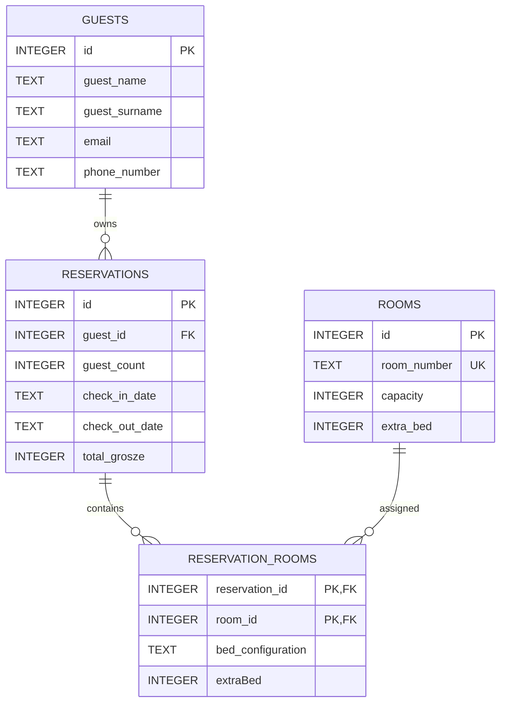

# HotelFlow — Database and Data Integrity

**Snapshot:** 11 November 2026. Source: `lib/database/database_helper.dart`, `room_repository.dart`, `reservation_repository.dart`, `guest_repository.dart`, and `pricing_repository.dart`. This is documentation of the **current schema**, with proposed improvements explicitly identified.

## 1. Storage architecture

HotelFlow uses an **embedded SQLite database** opened by the Dart `sqlite3` package (`sqlite3.open(dbPath)`), not a remote SQL server and not `sqflite`. The connection is held in `DatabaseHelper._database`. Initialization awaits `getApplicationDocumentsDirectory()`, joins the filename `hotel.db` using the `path` package, and executes `PRAGMA foreign_keys = ON;`.

As coded, data resides in the user's application Documents directory. On Windows this can be redirected to OneDrive; a local, non-synced application-data directory is preferable for a production SQLite file. `DatabaseHelper.createTables()` creates schema at startup and performs the current additive `total_grosze` migration; there is still no general version table or rollback migration system.

**Safety:** the database contains personal data (guest name, optionally email/phone). Never add `hotel.db` or real guest data to this public GitHub repository. Back up the database before changing schema or editing it in DB Browser for SQLite.

## 2. Current ER diagram



A reservation is linked to a guest and can contain multiple rooms through `reservation_rooms`. Each room assignment stores its bed configuration and extra-bed flag.

## 3. Schema: `rooms`

| Column | SQLite type | Rule | Meaning |
| --- | --- | --- | --- |
| `id` | `INTEGER` | `PRIMARY KEY AUTOINCREMENT` | Internal room ID |
| `room_number` | `TEXT` | `NOT NULL UNIQUE` | Human-readable room number, e.g. `'12'` |
| `capacity` | `INTEGER` | `NOT NULL` | Base occupants (seed: 2 or 4) |
| `extra_bed` | `INTEGER` | `NOT NULL DEFAULT 0 CHECK(extra_bed IN (0,1))` | 0/1 extra-bed option |

`RoomRepository.addRoom()` checks only nonempty room number and positive capacity. Room size is a business rule; it is not enforced by the SQL table constraint. Since inventory is fixed for this hotel, regular UI creation of arbitrary rooms may not be necessary.

### Inventory seeding

`DatabaseHelper.seedRooms()` loops from 1 through 24 and executes `INSERT OR IGNORE` into `rooms`. Rooms **12 and 24** have capacity **4** and `extra_bed = 0`; every other room has capacity **2** and `extra_bed = 1`.

`INSERT OR IGNORE` prevents duplicates where `room_number` already exists. **It does not repair existing incorrect capacity values.** Changing seeded rules does not automatically update an existing database.

## 4. Schema: `reservations`

| Column | SQLite type | Rule | Meaning |
| --- | --- | --- | --- |
| `id` | `INTEGER` | `PRIMARY KEY AUTOINCREMENT` | Reservation row ID |
| `guest_id` | `INTEGER` | `NOT NULL`, FK → `guests(id)` | Guest record |
| `guest_count` | `INTEGER` | `NOT NULL CHECK(guest_count > 0)` | Number of guests in this room |
| `check_in_date` | `TEXT` | `NOT NULL` | Arrival date |
| `check_out_date` | `TEXT` | `NOT NULL` | Departure date |
| `total_grosze` | `INTEGER` | `NOT NULL`, `CHECK >= 0` | Historical final reservation total in grosze |

Reservation totals are snapshots. They are calculated at booking time from the number of nights,
each selected room's nightly rate, and enabled extra-bed nightly rates. Later pricing changes do
not recalculate existing reservations. Older databases receive `total_grosze` through an additive
startup migration and existing rows default to `0` because their original pricing is unavailable.

## 4.1 Schema: `pricing_settings`

The singleton `pricing_settings` row stores the editable default nightly rates:

| Column | SQLite type | Meaning |
| --- | --- | --- |
| `capacity_two_grosze` | `INTEGER` | Default rate for capacity-2 rooms |
| `capacity_four_grosze` | `INTEGER` | Default rate for capacity-4 rooms |
| `extra_bed_grosze` | `INTEGER` | Default extra-bed rate |

The initial defaults are 30,000, 50,000, and 6,000 grosze respectively (300, 500, and 60 PLN).
Settings changes affect future booking drafts only. Reception can edit the nightly room and
extra-bed rates per room during a booking before the snapshot total is saved.

Other constraints in code: `FOREIGN KEY (guest_id) REFERENCES guests(id) ON DELETE RESTRICT`, `total_grosze >= 0`, and table-level `CHECK(check_in_date < check_out_date)`. `CREATE TABLE IF NOT EXISTS` does not retrofit all constraints to an old table; the current startup migration only adds missing `total_grosze`.

Dates are written by `ReservationRepository.addReservation()` as ISO calendar-day strings `YYYY-MM-DD`, via `.toIso8601String().split('T')[0]`. The test seeder uses the same format. The day and pagination queries sometimes apply `DATE(column)`; the availability query compares ISO strings directly.

### Important integrity gaps

- **Double-booking is not prevented on regular writes.** `ReservationRepository.addReservation()` uses a database transaction but does not repeat the room-overlap query at save time. The Home search and fake-data helper perform availability checks earlier.
- **Over-capacity reservations can be stored** by `addReservation()`: no SQL or repository validation checks `guest_count <= room.capacity` or optional extra-bed rules.
- **Zero-night stays:** repository validation rejects `checkInDate.isAfter(checkOutDate)` but does not itself reject equality; table CHECK rejects equal stored date strings. Validate before writing, with clear UI feedback.
- **Date normalization:** repository validity checks compare full `DateTime` values, then persist only the date. Normalize to calendar dates first.
- **Current/upcoming boundary:** `getReservationsPage()` uses `DATE(check_out_date) >= DATE('now')`; SQLite `'now'` defaults to UTC, which may differ from local hotel dates near midnight. Choose hotel-local calendar dates explicitly.
- **Price breakdown:** only the final historical total is stored; individual room-price snapshots are not persisted.

## 5. Reservation overlap and availability

A booking occupies a **half-open interval** `[check_in_date, check_out_date)`. Two bookings for the same room overlap exactly when:

```sql
existing.check_in_date < requested_check_out
AND existing.check_out_date > requested_check_in
```

Examples:

| Existing | Requested | Conflict? |
| --- | --- | --- |
| Nov 10–12 | Nov 11–13 | Yes |
| Nov 10–12 | Nov 12–14 | No: checkout and check-in meet |
| Nov 10–12 | Nov 8–10 | No |
| Nov 10–12 | Nov 10–12 | Yes |
| Nov 10–15 | Nov 11–12 | Yes |

`RoomRepository.getAvaliableRooms(checkIn, checkOut)` uses the following idea (method name retains the spelling in the repository):

```sql
SELECT rooms.*
FROM rooms
WHERE NOT EXISTS (
  SELECT 1
  FROM reservation_rooms AS rr
  JOIN reservations AS r ON r.id = rr.reservation_id
  WHERE rr.room_id = rooms.id
    AND r.check_in_date < ?
    AND r.check_out_date > ?
)
ORDER BY rooms.id ASC;
```

The parameters are `[requestedCheckOut, requestedCheckIn]`. This checks **the entire stay**, not a single date. **Precondition:** `requestedCheckOut > requestedCheckIn`; the repository currently does not independently enforce this.

Because only 24 rooms exist, the query returns at most 24 rows, regardless of reservation history size. The database still needs efficient index access to determine conflicts.

## 6. Reservation queries, search and pagination

**Active on selected day** (`getReservationsForDate`):

```sql
SELECT * FROM reservations
WHERE DATE(check_in_date) <= ?
  AND DATE(check_out_date) >= ?;
```

**Current / future reservation page** (`getReservationsPage`):

```sql
SELECT * FROM reservations
WHERE DATE(check_out_date) >= DATE('now')
ORDER BY check_in_date ASC, id ASC
LIMIT ? OFFSET ?;
```

The UI uses `page=0`, `pageSize=20`, and `offset=page*pageSize`. The active reservation panel accepts a search string and applies `reservation_search MATCH ?` through FTS5 before `LIMIT/OFFSET`; the history panel uses the same index with `check_out_date < today`. Empty queries bypass the FTS predicate and non-matching queries return an empty list. Both reservation search fields display the number of loaded results below the field. For very large histories, consider keyset pagination after measuring performance.

The guest panel uses the separate `guest_search` FTS5 index for partial multi-term searches. Indexes are rebuilt after guest/reservation mutations and at database initialization.

## 7. Indexes and search virtual tables

The current `createTables()` creates indexes for reservation dates, reservation-room lookup, and guest contact lookup. Verify indexes against the live database before adding more:

```sql
CREATE INDEX IF NOT EXISTS idx_reservations_dates
  ON reservations(check_in_date, check_out_date);
CREATE INDEX IF NOT EXISTS idx_reservation_rooms_room
  ON reservation_rooms(room_id, reservation_id);
```

These duplicate indexes waste space and add write overhead. **Keep one** after checking existing DBs and planned migration steps. An index for paginated date ordering could be evaluated using `EXPLAIN QUERY PLAN`; wrapping an indexed column in `DATE()` may prevent efficient index use. Do not add indexes blindly.

`DatabaseHelper.ensureSearchIndexes()` creates:

```sql
guest_search      USING fts5(guest_id UNINDEXED, guest_name, guest_surname,
                             email, phone_number)
reservation_search USING fts5(reservation_id, guest_id UNINDEXED, guest_name,
                              guest_surname, email, phone_number, guest_count,
                              check_in_date, check_out_date)
```

Reservation search terms are converted to quoted FTS5 prefix terms. The SQL must keep
`MATCH` as its own predicate; wrapping it in an `OR` null-check causes SQLite to reject the
statement with `unable to use function MATCH in the requested context`.

## 8. Test data and cleanup

The current startup path calls `seedRooms()` only. `ReservationRepository.seedFakeReservations({int count = 100})` is an explicit development helper and is not called from `main.dart`; any generated records should be treated as development data.

**Current risk:** `seedRooms()` still runs on every start, although `INSERT OR IGNORE` prevents duplicate room numbers. Review and guard all development seed helpers before production.

`ReservationRepository.removeReservationsOlderThanTwoMonths()` explicitly deletes reservations whose checkout is earlier than SQLite's calendar cutoff `DATE('now', '-2 months')`. It returns the deleted row count and rebuilds FTS indexes when needed. It is not scheduled automatically.

The fake helper creates guests with `guest_name` values such as `Test Guest 1` and
`guest_surname` values such as `Reservation 1`. Preview those records before deleting:

```sql
SELECT r.id, g.guest_name, g.guest_surname,
       r.check_in_date, r.check_out_date
FROM reservations AS r
JOIN guests AS g ON g.id = r.guest_id
WHERE g.guest_name LIKE 'Test Guest %'
  AND g.guest_surname LIKE 'Reservation %';
```

Only in a test database, after checking the preview and taking a backup:

```sql
DELETE FROM reservations
WHERE guest_id IN (
  SELECT id
  FROM guests
  WHERE guest_name LIKE 'Test Guest %'
    AND guest_surname LIKE 'Reservation %'
);
```

Do not run destructive queries against real guest data without a verified backup.

## 9. Current multi-room schema

The current normalized reservation assignment schema is:

```text
reservations
  id, guest_id, guest_count, check_in_date, check_out_date, total_grosze

reservation_rooms
  reservation_id -> reservations.id,
  room_id -> rooms.id,
  bed_configuration, extraBed
```

This permits a *single logical reservation* that reserves several rooms. The current repository writes the reservation and its room assignments, but overlap validation and a fresh transactional availability check remain follow-up work. Store `BedConfigurations` values consistently and document compatibility when enum labels change. The calendar reads from `reservation_rooms` joined with `reservations`.

## 10. Retention and backups

The main Reservations page excludes reservations whose checkout is before today. The Settings area provides a separate reservation-history panel for past bookings. The repository also exposes explicit cleanup after two calendar months from checkout, but this is not automatically invoked. Before scheduling deletion, confirm applicable legal, accounting, operational and personal-data retention obligations. With a desktop app, scheduled cleanup can run at startup or on relevant user actions; it does not run while the program is closed without an external scheduler.

Before production: choose a durable non-synced database path, implement backup/restore, handle migration/versioning, and test corrupted/missing DB scenarios. `PRAGMA foreign_keys = ON` is connection-specific and should be set every time a new connection opens.

## 11. Verification checklist

- [ ] A 24-room database has 22 rooms at base capacity 2 and rooms 12/24 at capacity 4.
- [ ] Re-running room seeding does not duplicate rows.
- [ ] Fake reservation count is checked; the helper returns the number created.
- [ ] Overlapping stays are rejected again at reservation save time.
- [ ] Adjacent stays (check-out = next check-in) are permitted.
- [ ] Check-in = check-out and check-out < check-in are rejected.
- [ ] Room capacity/extra-bed constraints are enforced at booking save.
- [ ] Current day is computed in the hotel's local timezone.
- [ ] FTS searches cover guest names, contact details, dates, guest count and reservation ID.
- [ ] Sample data is disabled in release builds.
- [ ] DB backup + recovery are tested before client deployment.
